---

## [?] About Me

I'm a cybersecurity student driven by questions such as: `why()` · `how()` · `what_breaks()`

I learn by building. Every project gets tested thoroughly: `build()` → `test()` → `break()` → `understand()`

That curiosity is what pulled me into security. I'm aiming for a role where it helps `protect()` people and systems.

---

## [?] Working On

| Currently                                                                                                             | Overview                                             |
|:----------------------------------------------------------------------------------------------------------------------|:-----------------------------------------------------|
| [**Building**](https://github.com/Daemanic/Web-Honeypot)                                                              | Web honeypot with attack dashboard                   |
| [**Practicing**](https://tryhackme.com/p/abslute)                                                                     | TryHackMe practical challenges and roadmaps          |
| [**Learning**](https://profile.hackthebox.com/profile/01a0c47a-bc76-735b-b0e1-305ec1aa20f3?utm_medium=copy_url)       | HackTheBox academy foundation and active resources   |

---

## [?] Tech Stack


---

```python
while not understood:
    build()
```
